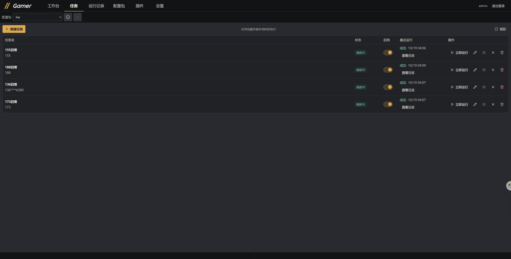
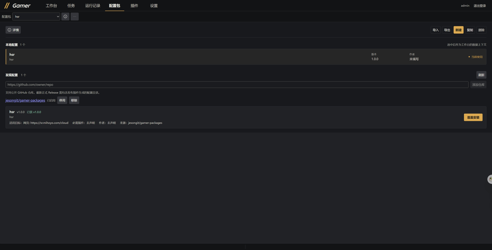

<p align="center">
  
</p>

<h1 align="center">Gamer</h1>

<p align="center"><strong>在浏览器里查看画面、操作目标、编排自动化。</strong></p>

<p align="center">
  面向 Android 设备与浏览器游戏的自托管工作台，集实时控制、视觉匹配、YAML 脚本和定时任务于一处。
</p>

<p align="center">
  <a href="https://github.com/jesongit/gamer/releases/latest"></a>
  <a href="https://github.com/jesongit/gamer/actions/workflows/ci.yml"></a>
  <a href="https://hub.docker.com/r/posase/gamer"></a>
</p>

<p align="center">
  <a href="https://jesongit.github.io/gamer/">使用文档</a> ·
  <a href="https://github.com/jesongit/gamer/releases/latest">下载 Windows 版</a> ·
  <a href="#快速开始">快速开始</a> ·
  <a href="docs/guides/DOCKER.md">Docker 部署</a> ·
  <a href="https://github.com/jesongit/gamer/issues">反馈问题</a>
</p>



<p align="center"><sub>当前版本任务界面：调度状态、运行结果和操作入口集中展示。</sub></p>

[功能亮点](#功能亮点) · [界面预览](#界面预览) · [使用流程](#使用流程) · [插件仓库](https://github.com/jesongit/gamer-plugins) · [连接外部 Agent](#连接外部-agent) · [开发与贡献](#开发与贡献)

## 功能亮点

- **统一查看与操作**：Android 通过 ADB / scrcpy 接入，浏览器目标使用独立浏览器资料。支持单屏、4 格和 9 格预览，切回单屏即可操作目标。
- **让脚本按画面行动**：用图像模板、本地 OCR、等待、分支与函数组织流程。YAML 原文可直接编辑，正式脚本独立执行，无需模型或 Agent 在线。
- **把重复操作交给任务**：按目标保存执行入口、参数和调度时间。服务端持续运行时，关闭管理网页不影响后台任务。
- **从操作素材走向可复用流程**：录制画面与操作事件，逐帧查看、标记目标、提取模板，制作可携带的 `.gamersample` 素材包。
- **保留修改与执行依据**：工作稿按版本保存，支持检查、私有试跑与人工发布；日志和 Runtime Trace 帮助回看执行步骤与判断画面。
- **按需扩展能力**：配置包组织脚本、模板与映射，插件提供编辑和执行能力；自己的外部 Agent 可通过受限 MCP 接入。

## 界面预览

配置包页同时管理本地内容与公开仓库中的配置，可在同一页完成选择、导入导出、复制和发现配置。



<sub>截图为 Gamer 0.4.0 的界面示例；所示配置和任务为已有内容，首次安装不会预置。</sub>

## 快速开始

| 运行方式 | 适合场景 | 入口 |
| --- | --- | --- |
| Windows x64 完整便携包 | 在个人电脑上直接使用 | [下载发行版](https://github.com/jesongit/gamer/releases/latest) |
| Docker | 在持续在线的主机上运行 | [部署、迁移与备份指南](docs/guides/DOCKER.md) |
| 从源码运行 | 开发、调试或自行构建 | [源码启动步骤](#从源码运行) |

### Windows：解压即用

1. 下载 `Gamer-<版本>-windows-x64-full.zip`，完整解压到可写目录。
2. 双击 `Gamer.exe`，等待程序打开浏览器，在本机页面设置管理员密码。没有预设密码。
3. 进入「插件」页，按需安装功能，具体选择与用法见[官方插件仓库](https://github.com/jesongit/gamer-plugins)。
4. 按下方流程接入目标、选择配置包并创建自己的内容。

完整包包含运行依赖，无需安装 Rust、Node.js 或 pnpm。关闭网页后服务仍在托盘运行；退出服务使用托盘菜单。软件更新在「设置 → 软件更新」进行，个人配置和数据应保留。详见[便携版与更新](docs/guides/UPDATE.md)。

### Docker：持续运行

官方镜像为 [`posase/gamer`](https://hub.docker.com/r/posase/gamer)，包含静态前端、Chromium、ADB、FFmpeg 和本地 OCR。请按[部署指南](docs/guides/DOCKER.md)完成数据卷、管理员密码、浏览器沙箱与网络配置；镜像实际发布的平台以对应版本说明为准。

已有安装升级或迁移时，先备份并复用完整数据；容器通过替换镜像更新。宿主休眠或关机时，定时任务无法执行。

### 从源码运行

<details>
<summary>展开环境与启动命令</summary>

以下命令在 Windows PowerShell 中执行。先准备 Rust stable、对应链接工具链、Node.js 24、ADB、FFmpeg 和 ffprobe，并将工具加入 `PATH`。Windows MSVC 构建需要 C++ Build Tools；配套 scrcpy server 已随仓库提供。

```powershell
git clone --recurse-submodules https://github.com/jesongit/gamer.git
Set-Location gamer

npm install --global pnpm@11.23.0
rustup target add wasm32-unknown-unknown

if (-not (Test-Path .\server\config.toml)) {
    Copy-Item .\server\config.example.toml .\server\config.toml
}

pnpm --dir web install --frozen-lockfile
.\tools\build-plugins.ps1
.\gamer.ps1 start
```

打开 [http://localhost:5173](http://localhost:5173)，在本机完成首次密码设置。服务端默认地址为 `http://localhost:8443`；端口号不表示已启用 HTTPS。

已有工作区使用 `git submodule update --init --recursive` 恢复主仓锁定的插件提交。`plugins/` 来自独立的 [gamer-plugins](https://github.com/jesongit/gamer-plugins) 仓库，不使用 `--remote` 跟随最新分支。

完整安装说明见[安装与首次启动](docs/site/guide/installation.md)，配置项见 [config.example.toml](server/config.example.toml)。

</details>

## 使用流程

1. **接入目标**：Android 先确认 `adb devices -l` 中设备已授权，再扫描或填写地址；网页目标在工作台添加浏览器目标并打开网址。参见 [ADB 接入](docs/reference/DEVICE_ACCESS.md)和[浏览器目标](docs/guides/browser-targets.md)。
2. **选择应用与配置**：Android 应用决定操作对象，配置包决定使用哪组脚本与模板，两者独立。可以使用首次启动创建的空白默认配置，或导入 `.gamerpkg`。
3. **编写并验证**：在「工作台」编辑脚本、模板或映射；也可以先通过视频工作台制作素材，再由人工或外部 Agent 编写工作稿。检查后试跑所选版本，结合日志与画面核对结果。
4. **发布并安排任务**：审查通过后人工发布，需要重复执行时在「任务」页选择目标、入口、参数和时间。

首次安装不附带游戏脚本、模板或映射。工作台功能来自已启用插件，也会受插件声明的目标应用范围影响。

4 格和 9 格用于监看；点击画面进入单屏后才允许输入。关闭预览或移出网格不会停止后台脚本，同一目标最多保留一个活动运行。详见[多画面与独立运行](docs/guides/multiview.md)。

## 插件

自动化、按键映射、视频、通知和直播等功能的介绍、使用示例、构建与开发说明，统一维护在 [gamer-plugins 官方插件仓库](https://github.com/jesongit/gamer-plugins)。主仓通过固定提交引用插件源码，发行包使用锁定的已发布目录。

## 连接外部 Agent

Gamer 提供画面、受控操作、资源和执行证据。模型、对话与规划由你选择的外部 Agent 负责，Gamer 不内置模型请求、聊天或 Agent 循环。

在「设置 → MCP 与外部控制」创建令牌，明确允许的操作、目标、配置包和插件范围，然后在同机 Agent 中配置 Streamable HTTP 端点，例如：

```text
http://127.0.0.1:8443/api/mcp
Authorization: Bearer <你的 MCP 令牌>
```

请使用设置页显示的实际地址。MCP 检查真实回环连接，使用独立令牌；管理员登录不能替代授权。直接控制需要用户先在管理界面开始或恢复会话，正式发布由用户完成。Docker 的容器外接入限制见部署指南。

接入步骤、权限与客户端检查见 [MCP 指南](docs/guides/external-agent-mcp.md)。

## 数据与运行环境

配置包用 `.gamerpkg` 导入导出，插件用 `.gplugin` 分发，独立操作素材用 `.gamersample` 携带。配置包导出默认登记媒体引用，需要携带视频时选择包含媒体。

源码运行的数据默认在 `server/data/`，Windows 完整包使用安装目录中的 `config/` 和 `data/`，Docker 使用持久数据卷。配置包导出只覆盖该包的内容；完整恢复需要停机备份配置与全部数据，包括数据库、插件、历史版本、媒体、浏览器资料和凭据密钥。详见[配置包指南](docs/site/guide/packages.md)和[备份与迁移](docs/guides/DOCKER.md)。

Android 镜像主屏与虚拟屏分别设置，虚拟屏能力取决于系统和应用。默认 WebRTC 使用 host candidate 直连，没有内置 STUN/TURN；跨 NAT 时，打开网页与视频可达需要分别核对。浏览器目标的登录、输入与云游戏平台兼容性同样需要实际验证。

## 开发与贡献

服务端使用 **Rust / axum / WebRTC**，前端使用 **Vue 3 / Vite**。Core 提供目标、控制、视觉、资源、媒体、运行和任务机制；业务功能由插件提供。

```text
server/     Rust 服务端与稳定机制
web/        Vue 主界面与插件 UI 宿主
plugins/    官方插件源码，固定提交 submodule
sdk/        插件接口、UI SDK 与示例
updater/    便携启动、托盘与更新引擎
release/    发布契约、依赖锁与打包工具
docs/       使用手册、接口参考与设计文档
tools/      构建、检查与开发辅助工具
```

常用命令在仓库根目录执行：

```powershell
.\gamer.ps1 status                         # 查看本地服务状态
.\gamer.ps1 restart -Build                 # 重新构建服务端并重启
pnpm --dir web build                      # 只构建前端壳
node tools/check-plugin-sdk.mjs            # 校验插件 SDK 一致性
```

普通前端构建只构建主界面壳。插件的构建、联调与独立发布说明统一见[插件仓库](https://github.com/jesongit/gamer-plugins)。

提交改动前按[测试说明](tests/README.md)运行与改动相关的检查；完整质量入口为 `tools/ci-local.ps1`。项目约定见 [AGENTS.md](AGENTS.md)。反馈问题时请附版本、运行方式、复现步骤和脱敏日志。

## 更多文档

| 想了解什么 | 阅读入口 |
| --- | --- |
| 安装、首次使用与工作台 | [安装指南](docs/site/guide/installation.md) · [快速上手](docs/site/guide/getting-started.md) · [工作台](docs/site/guide/workbench.md) |
| 自动化、素材与插件 | [官方插件仓库](https://github.com/jesongit/gamer-plugins) |
| 执行证据 | [Runtime Trace](docs/reference/RUNTIME_TRACE.md) |
| 设备与浏览器 | [ADB 接入](docs/reference/DEVICE_ACCESS.md) · [浏览器目标](docs/guides/browser-targets.md) · [多画面](docs/guides/multiview.md) |
| 配置、任务与通知 | [配置包](docs/site/guide/packages.md) · [任务](docs/site/guide/tasks.md) · [通知](docs/guides/notifications.md) |
| 部署、更新与排查 | [Docker](docs/guides/DOCKER.md) · [便携版更新](docs/guides/UPDATE.md) · [问题排查](docs/site/guide/troubleshooting.md) |
| 外部 Agent 接入 | [MCP](docs/guides/external-agent-mcp.md) |

Gamer 的 Android 画面采集基于 [scrcpy](https://github.com/Genymobile/scrcpy)。第三方组件的版本、来源与许可说明见 [NOTICE](licenses/NOTICE.md)和[依赖锁](release/dependencies.lock.toml)。
