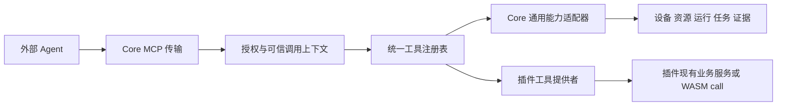

# Gamer 外部 Agent 与统一 MCP 改造计划

状态：用户已于 2026-10-16 确认，按阶段实施中。阶段结果见 [改造进度与验证记录](../evidence/EXTERNAL_AGENT_MCP_REFACTOR_PROGRESS.md)。

本次改造将模型连接、对话、规划和生成交给用户选择的外部 Agent。Gamer 保留设备与浏览器控制、确定性自动化、插件、配置包、素材、版本、任务和运行证据，通过统一 MCP 提供这些能力。

现有正式脚本、函数、模板、素材、工作稿、大小版本、发布历史和运行记录必须保留。删除 AI 功能不包含删除 AI 曾经产生的数据。

当前授权为本地分阶段实施与验证，先完成完整备份，并在每阶段报告结果。暂不部署、不更新现有安装、不操作真实设备或实际游戏目标。所有实施测试使用隔离数据和合成目标，原数据不迁移、不清理。

## 1 改造目标与首版范围

### 1.1 产品职责

| 责任方 | 职责 |
| --- | --- |
| 外部 Agent | 理解用户要求、选择模型、维护对话与通用记忆、搜索资料、编写或修正脚本、根据证据决定下一步 |
| Gamer Core | 目标与连接、输入仲裁、资源存储、媒体与录制、运行与任务、日志与 Trace、MCP 协议和外部调用授权 |
| Gamer 插件 | 声明业务工具并执行确定性操作，提供自己的语法、资源校验、Runner、功能面板和使用资料 |
| 用户 | 配置外部 Agent 与 MCP 授权、开始和恢复外部控制、人工接管、决定正式发布版本 |

已有配置包和定时任务继续在没有 Agent 的情况下使用。外部 Agent 的对话入口位于其客户端；Gamer 提供连接配置、当前控制者、运行状态、暂停、停止和证据入口。

### 1.2 首版决定

1. 统一 MCP 是宿主的通用接口，不再依赖 `gamer-ai`；插件不分别实现 MCP 服务。
2. 插件显式声明工具。工具执行复用现有业务服务、PackageStore、Runner 和权限门禁。
3. 第一轮不迁移脚本、素材和版本的目录或格式，不批量重写 YAML，不修改现有业务数据库 schema。
4. 新 MCP 令牌独立签发；旧 AI 密钥、令牌和私有配置原样封存，不自动继承为新权限。
5. 保留人工发布大版本。首版 MCP 可以编辑工作稿、校验和请求试跑，正式发布、回退和删除仍由 Gamer 管理界面执行。
6. 外部直接输入仍须由用户在 Gamer 开始控制；暂停后由用户恢复。MCP 不提供启动或恢复控制的管理捷径。
7. 首版沿用本机 Streamable HTTP 和独立 Bearer。远程访问、OAuth、多租户、Agent 托管、模型调用和通用记忆平台不进入本次范围。
8. 先接通 Core、YAML 和素材的完整工作流，再删除 AI 执行代码；OCR、键盘映射和直播按明确工具清单接入。

## 2 当前实现与必须先解决的问题

计划基于主仓 `42abcdef3041dd07fba946730e9e3ebf56d3d378`、插件仓 `74c690c7b8380b91d70a5277485a40f7c4312dfb` 及当前未提交工作区。实施前重新核对差异，不覆盖其他进行中的改动。这些标识不代表当前部署版本。

| 当前实现 | 改造影响 |
| --- | --- |
| `server/src/api/extension_mcp.rs` 是插件协议薄路由，调用 `BuiltinService::mcp` | 不能只删除 AI 插件；协议入口须先迁为 Core 的 `/api/mcp` |
| MCP 令牌、目录、输入和会话在 `plugins/gamer-ai/host/` | 拆出中立授权、会话和工具执行，移除模型循环 |
| `gamer-yaml/host/generation.rs` 混合候选、模板、验证、发布、回退和模型请求 | 不得整文件删除，必须先拆确定性服务 |
| `generation/authoring.rs` 同时管理工作稿大小版本和 `authoring.generate` | 保留版本模型与保存、校验、试跑、发布，仅删除模型生成入口 |
| 插件已有 capabilities 与 `action + JSON`，普通 WASM action 绑定 declarative 按钮 | 增加独立于 UI 的工具声明，并补每次调用的可信上下文 |
| 工作稿、候选、发布历史位于 `extension-data/gamer-yaml/` | `.gamerpkg` 导出不足以备份这些数据 |
| 新素材位于 `plugin-data/gamer-video/samples/`，独立于 Package | 必须保留独立素材库；不得按旧文档假定它全部在包内 |
| 安装记录会遍历历史 manifest，权限解析是封闭集合 | 直接删除 `ai.connect` 解析会导致旧版本影响整个插件列表，见第 11 节 |

## 3 删除迁出与保留清单

### 3.1 删除的活动功能

| 功能 | 主要代码或入口 | 最终处理 |
| --- | --- | --- |
| 模型供应商适配 | `gamer-ai/host/provider.rs`、`settings.rs` | 删除 Responses、Chat Completions 等模型协议、密钥编辑、模型参数和连接探测 |
| 内置聊天与 Agent | `conversation.rs`、`prompts.rs`、内置游玩循环 | 删除聊天发送、自动规划、内部交接、工具自循环和系统提示词设置 |
| AI 预算与使用量面板 | 模型 token、轮次、费用和生成预算 UI | 删除活动配置与预算逻辑；旧版本中的 usage 和 diagnostics 字段保留为历史元数据 |
| 模型生成与修复 | `gamer-ai/host/automation.rs`、`authoring.generate`、generation 模型分支 | 删除 readiness、模型生成、自动纠错、自动生成小版本入口 |
| 宿主自主工作流 | `generation/autonomy.rs` 中的决策循环、`AutomationBridge` | 删除宿主自动规划、反复修复和自动发布；其中私有候选执行适配器先迁出 |
| 自动记忆加工 | `memory_agent.rs`、`memory_checkpoint.rs`、`memory_context.rs`、Embedding 和检索索引 | 删除自动归纳、模型导入、语义索引维护与 Agent 记忆工具；原始资料和修订数据保留 |
| 通用搜索服务配置 | `services.rs`、服务配置页 | 删除供内置 Agent 使用的搜索和 Embedding 供应商连接 |
| AI 插件活动面板 | `plugins/gamer-ai/ui/` | MCP 与控制入口迁出后，删除对话、模型、Prompt、记忆和 AI 游玩面板 |
| AI 发行与装配 | builtin 注册、默认构建、市场目录、依赖声明 | 移除 `gamer-ai` 的宿主装配和官方新发行项；历史安装包与数据保留 |

模型图像编码、`jpegli`、`sqlite-vec`、`jieba-rs` 等依赖在使用点拆除后再确认删除。`image`、HTTP、SQLite、SHA 和媒体依赖仍有普通功能使用，不按名称批量删除。OCR、模板匹配、规则驱动的直播自动流程和定时任务均保留。

### 3.2 从 AI 迁出的基础能力

| 能力 | 目标归属 | 保留约束 |
| --- | --- | --- |
| MCP JSON-RPC 与传输 | Core `mcp` 模块和 API 路由 | 协议处理不理解 YAML、游戏规则或模型协议 |
| 令牌与授权 | Core MCP 凭据存储和设置接口 | 独立 Bearer、过期、撤销、范围过滤和脱敏 |
| 外部控制会话 | Core 外部控制服务 | 使用现有 RunManager、ActivityLease 和 ControlRegistry |
| 截图与输入工具 | Core 工具适配器 | Android/browser 能力过滤、真实图像、坐标映射、FrameStamp 与 operation_id |
| 工具调用审计 | Core 运行事件与 MCP 操作收据 | 记录接收的调用和结果，不伪造外部 Agent 的推理或完整对话 |
| 工作稿与候选处理 | YAML 插件的非 AI 服务 | 不因拆服务改变原目录、身份或版本号 |
| 失败证据读取 | Core 日志/Trace，加 YAML 的版本说明 | 精确绑定 run_id、Package、源码版本和实际判断帧 |

### 3.3 原样保留的业务能力

- 唯一 YAML 解析器、解释器、原生函数目录、Package 函数库和现有 Runner。
- 原文编辑、工作稿新建和导入、小版本保存、差异、历史、大版本发布、事务与回退。
- 正式脚本和私有版本试跑，参数绑定与运行守卫。
- 素材制作、导入导出、截图、原始事件、模板裁切与匹配检查。
- 配置包、媒体 refs、Android/browser 目标、录制、WebRTC、人工输入和键盘映射。
- 通用任务、调度、运行记录、日志、Runtime Trace 和显式保留证据。
- 插件安装、启用、禁用、更新、卸载及原有权限与数据隔离机制。

## 4 数据保留与升级保护

### 4.1 保留目录

下表的 `data/` 指实际 `config.data_dir`，不假定始终为 `server/data/`。外置媒体和录像目录一并按当前配置纳入清单。

| 数据 | 当前位置 | 升级要求 |
| --- | --- | --- |
| 正式 YAML、函数、模板及旧包内素材 | `data/packages/<pkg>/plugins/gamer-yaml/` | 原路径、字节、文件名和资源版本保留 |
| 工作稿与全部大小版本 | `data/extension-data/gamer-yaml/authoring/<pkg>/<sha256(script_id)>.json` | 不搬目录、不重编号、不重建 document_id |
| 发布事务与修改前内容 | `data/extension-data/gamer-yaml/revisions/<pkg>/<revision-id>/` | 保留 `revision.json`、before 内容和版本哈希 |
| 不可变发布锚点 | 上述 revisions 下的 `authoring-published/<sha256(script_id)>.json` | 不随工作稿删除或重建，不改写旧发布快照 |
| 旧候选和冻结环境 | `data/extension-data/gamer-yaml/candidates/<pkg>/<id>.json` 与 `.snapshot` | 成对保留，含素材、模板、函数、报告和裁切信息 |
| 独立素材库 | `data/plugin-data/gamer-video/samples/<id>.gamersample` | 保留样本 ID、内容摘要、PNG 与原始事件 |
| 媒体与录制 | `data/media/`、`.recording-history/` 及配置的外部位置 | 保留媒体/录制 ID、原视频、元数据、事件和 refs |
| 业务数据库 | `data/gamer.db` | 保留运行、事件、任务、调度、设备和其他现有记录 |
| 临时与保留 Trace | `data/runtime-traces/`、`data/retained-traces/` | 保留当前存在的图像、快照和引用；不借升级触发额外清理 |
| AI 包内资料 | `data/packages/<pkg>/plugins/gamer-ai/` | 按 dormant 插件资源保留，导入导出继续透传 |
| AI 私有数据 | `data/extension-data/gamer-ai/` | 对话、导入任务、凭据和缓存原样封存，不提供默认 MCP 读取 |
| 未识别插件文件与旧项目 | 原位置 | 作为不透明数据保留，不由新服务猜测用途或清理 |

所有 Package/script/document/sample/candidate/revision/run/task ID、版本号、源码字节、模板哈希、`material_refs`、`generated_templates` 和发布锚点保持有效。历史模型来源、usage 和诊断字段不因界面去掉 AI 而丢弃；读取后保存新版本也不得静默丢掉旧字段。

### 4.2 升级不能执行的操作

1. 不用“删除 Package 再导入”进行迁移；Package 删除钩子会清理其 authoring、candidate 和 revision 数据。
2. 不带 `delete_data=true/1/yes` 卸载插件；此参数会删除对应 `extension-data/<plugin-id>`。不卸载并清空 YAML 插件。
3. 不把 `.gamerpkg` 作为完整备份。它不包含私有版本、独立素材库、全局 journal/Trace 和 AI 私密数据；默认还只包含媒体引用。
4. 不批量转换旧候选为工作稿、不修改旧 run 的 runner_id、不重新编号或重命名旧目录。
5. 不把旧模型配置解密为明文，不把旧 MCP 令牌复制成新令牌，不把历史元数据当作执行授权。

### 4.3 批准后的备份流程

先记录所有实际数据位置、媒体输出位置和当前安装版本，阻止新调度、新运行、录制和编辑写入入场，再等待活动运行、录制、媒体输出、插件后台写入与资源事务排空，取得数据库和文件的同一时点快照。数据库使用停写后的稳定快照或 SQLite backup API，不能在运行时只复制 `.db` 并遗漏 WAL。SQLite backup API 只保证单个数据库一致，不能代替跨数据库、工作稿、素材、版本和媒体 refs 的停写协调。

备份覆盖完整 data、外置媒体/录像目录、配置、原宿主和插件归档，形成可恢复的一组。记录相对路径、大小、SHA-256，以及各类 ID、数量和引用关系；报告不输出凭据内容。DPAPI 加密文件原样备份，跨 Windows 账户解密不作为恢复保证。

先在隔离副本验证恢复和升级。数据对照期间控制清理计时，区分升级前已过期的 Trace 与升级造成的丢失。正式切换不运行新增清理，不改变现有业务保留策略。

## 5 统一 MCP 架构

### 5.1 模块改法

| 位置 | 计划修改 |
| --- | --- |
| `server/src/mcp/` 新模块 | 分离 protocol、credentials、context、catalog、dispatch、receipts 和 Core 工具；不引入游戏业务 |
| `server/src/api/mcp.rs` 新路由 | 提供 `/api/mcp`，独立认证；移除对 `BuiltinService::mcp` 的依赖 |
| Core 外部控制服务 | 从 `gamer-ai` 提取 MCP 模式会话，复用控制屏障和运行生命周期；不包含对话或模型状态 |
| `server/src/extensions/` | 增加工具描述、运行期注册和外部调用分发；停用/更新时协调调用与取消 |
| 插件 host 适配器 | 由插件声明工具并转发到现有业务方法；Core 不写 gamer-yaml action 分支 |
| `server/src/main.rs` | 组合根装配 MCP、Core 工具、插件工具提供者和外部控制；去掉 AiService |
| `plugins/sdk/` | 同步工具声明格式、Schema 验证与调用上下文契约；不增加新的插件执行类型 |

工具目录取交集：显式允许外部调用的工具、当前 Running 的插件工具、令牌允许的 scope 和资源范围。Core 工具不依赖任何业务插件；卸载全部业务插件后，设备、运行历史等基础工具仍可用。

插件目录按名称稳定排序并支持分页。每次 `tools/list` 反映当前状态；实际执行时重新检查，避免使用旧目录绕过停用或撤销。

新增接口分为两个认证域，不能共用隐式管理员身份：

| 接口 | 身份与用途 |
| --- | --- |
| `POST /api/mcp` | 独立 Bearer，处理 MCP 请求；无服务端流时 GET 返回 405 |
| `GET/POST /api/mcp/tokens`、`DELETE /api/mcp/tokens/:id` | 原管理认证与跨站请求防护，管理令牌；MCP 工具不能调用它们 |
| `/api/external-control/sessions` 及按 session 的管理动作 | 原管理认证，开始、查询、暂停、恢复、停止外部控制；从 AI 面板迁出的服务不提供模型 mode |

令牌列表和查询不返回秘密，创建时仅显示一次新秘密。旧 `/api/extensions/:id/call` 继续服务其他插件，但不能成为 MCP 的通用转发工具。

### 5.2 传输与协议范围

- 首版保持本机 Streamable HTTP，POST 返回 JSON，通知返回 202；不提供独立的每插件 MCP 地址。
- 以当前使用的 `2025-11-25` 为首个验收基线。既有其他协议版本仅在相关返回格式和契约测试通过后继续协商；未验收的新版本不宣称兼容。
- 校验真实回环 peer、Host、Origin、Bearer、内容类型与协议版本；不接受管理员 Cookie 或代理头替代外部身份。
- 首版不实现服务端推送流时，GET 返回 405，声明 `tools.listChanged=false`。插件变化在重新枚举时生效，设置页提示客户端刷新或重连；不能声明已支持变化通知。
- 后续若有实际需要再补 SSE 和工具变化通知；长任务首版通过显式业务 ID 查询，不依赖可选 MCP Tasks、sampling 或 elicitation。
- MCP 传输关联、外部控制 session_id、业务 run_id 和输入 frame_id 分开，不能混用。

协议基线采用 [MCP 2025-11-25 传输规范](https://modelcontextprotocol.io/specification/2025-11-25/basic/transports)。这里选择与当前实现衔接的基线，不将其称为最新协议。

## 6 插件工具契约与 SDK 改法

### 6.1 工具描述

定义轻量 `ToolDescriptor`，builtin/官方 host 适配器与 WASM 使用同一描述和目录校验。

| 字段 | 含义 |
| --- | --- |
| `tool_id` | 插件内稳定标识，由宿主生成完整命名空间 |
| `description` | 说明用途、输入单位、作用范围和前置条件 |
| `input_schema` | JSON Schema，限定参数、长度、类型、范围与未知字段 |
| `output_schema` | 可选结果 Schema，结果必须与声明一致 |
| `action` | 对应插件现有确定性业务操作，不是任意 HTTP 或文件路径 |
| `required_permissions` | 所需插件权限，必须属于插件已获权限集合 |
| `required_scopes` | 外部令牌所需授权，由宿主核验 |
| `context` | 是否要求目标、Package、特定运行或控制会话 |
| `effect` | 读取、编辑草稿、提交运行、持久任务等实际影响，用于默认开放策略和审计 |
| `execution` | 同步或返回现有 run/job ID，及超时、取消、去重要求 |

完整工具名采用 `gamer.core.<tool_id>` 和 `gamer.plugin.<plugin-id>.<tool_id>`。安装/注册时检查长度、字符和冲突，不通过替换连字符等有歧义的归一化生成名字。描述与 annotations 帮助客户端理解操作，实际授权仍在服务端执行。

WASM manifest 增加可选 `[[tools]]`，Schema 通过归档内受校验的相对路径引用，禁止远程 `$ref` 和越界路径。没有工具声明的现有插件继续运行，只是不自动获得 MCP 工具。工具与 declarative UI 按钮各自声明，共用同一业务 action 可以复用实现。

首版不自动转换全部 native action、全部按钮或全部函数为工具。YAML 的原生函数和 Package 函数作为文档与 Schema 目录提供，脚本/函数执行走 Runner。

### 6.2 每次调用的可信上下文

现有 WASM `extension.call(action, values-json)` 可继续复用，但宿主目前在 start 时绑定的 AppContext 不足以处理不同外部调用。必须同步修改宿主运行时：

1. 增加内部 `InvocationContext`，包含 token_id、来源、授权范围、冻结的 AppContext、operation_id、取消信号，以及需要时的控制身份。
2. 上下文由 MCP 认证和范围检查产生，经宿主 RuntimeCommand 传入。JSON 中的 owner、human、principal、generation 等字段不能创建身份或扩大权限。
3. WASM worker 在本次串行调用内绑定上下文，只有 guest 实际结束或被安全终止后才还原；HTTP future 取消不能提前切换 HostState。`context.get` 和 host imports 读取本次绑定值，不能沿用上次 start 的 Package 或目标。
4. 每个资源、设备、输入和运行 host import 同时检查插件权限与外部调用范围；包括 guest 先前保存的句柄，每次使用也要复核当前调用授权。只检查 manifest 权限或只在 resolve 时检查不足以阻止跨调用访问。
5. 本次工具执行及其尚未正式提交的异步工作保留相同授权和取消约束；已接受的独立运行按第 8.2 节转换为绑定业务 ID 的执行授权。外部身份不能泄漏给下一次 UI、事件或其他令牌调用；受控输入继续携带 admission guard 和代次。
6. 官方 host/builtin 业务适配器遵守相同规则，拒绝参数中的越权 Package/device/run，而不是仅在工具入口检查一次名称。

新增 `call_extension_from_external` 一类内部入口，经过专用外部上下文，再进入现有 Running、call lease、权限和 action 分发门禁。不得让 MCP 以管理员身份调用 `call_extension`，也不能构造假插件身份调用内部协作 action。

## 7 首版工具范围

下表是拟实现的工具族；具体工具名沿用第 6 节命名空间。只有实现、权限检查和结果契约完成的工具才进入目录。

| 工具族 | 首版操作 | 边界 |
| --- | --- | --- |
| Core 资料与能力 | 使用指南、当前上下文、插件/Runner/provider 目录 | 返回版本和能力，不自动安装或启用插件 |
| Core 目标与观察 | 目标列表、状态、最新截图 | 仅授权目标；截图返回真实 MCP image 和尺寸、坐标、frame_id 元数据 |
| Core 外部控制 | status、keepalive、pause、release；点击、长按、滑动、按键、文本、当前应用启停 | 用户先在 Gamer 开始会话；每次输入核对 session/generation/frame 与 owner |
| Core 资源 | Package 概览、资源枚举和读取 | 首版通用接口只读；私密目录和任意系统路径不可访问 |
| Core 运行 | 参数说明、submit、status、wait、cancel、历史记录 | 使用真实 Runner；按目标、Package、runner 和 run 范围过滤 |
| Core 任务 | 读取、创建/修改、启停和单次执行 | 默认仅开放读取；持久任务写入和控制单独授权 |
| Core 证据 | 日志分页、事件游标、Trace 索引、实际判断图和源码快照 | 历史 Runner 不在也能读取；不以全局最新运行替代指定 run_id |
| YAML 工作稿 | list/get/create/import/save/diff、校验、素材检查、试跑 | 保存新增小版本，正式发布/回退/删除仍由管理界面执行 |
| YAML 历史 | 发布历史、事务历史、旧候选与冻结内容的读取/导出 | 不自动转换；显式导入旧候选时创建新工作稿并记录来源 |
| YAML 视觉与模板 | 模板读取、从授权图片裁切私有模板、匹配检查、函数/语法目录 | 使用原图坐标、内容哈希和受控大小；不直接覆盖正式模板 |
| 视频与素材 | 素材 list/read、帧索引/单帧、原始事件、导入导出、制作素材 | 复用 sample 与录制接口；消费已导出的自包含素材不依赖原视频 |
| 键盘映射 | 方案枚举、读取、校验和写入 | 走现有资源钩子；首版不公开 guest handle/event 或增加热切换机制 |
| OCR | recognize、status | 复用插件能力和授权图像；不开放服务凭据设置 |
| 直播 | 状态、规则预览/读取、队列状态；按授权开放规则修改和推流控制 | 沿用现有服务端队列；凭据设置、sender.send 和内部确认 action 不默认开放 |

通用资源 write/delete 首版不开放，防止绕过 YAML 工作稿和人工发布边界。插件需要写入时使用其语义工具并经过原资源钩子。正式脚本执行与私有版本试跑保留不同身份，工具不能把私有内容冒充已发布资源。

Core 可提供 `gamer://` 资源 URI，用于规范、源码、素材和 Trace，所有读取复核令牌范围。关键资料同时提供普通读取工具，客户端只支持 tools 时也能完成主工作流。图片使用 MCP image content；大文件使用分页、受控资源引用或现有导入导出通道，结果明确标记摘要、大小、截断和后续游标。

工具 Schema 和图像/结构化返回遵循 [MCP 工具规范](https://modelcontextprotocol.io/specification/2025-11-25/server/tools)，资料 URI 遵循 [MCP 资源规范](https://modelcontextprotocol.io/specification/2025-11-25/server/resources)。

## 8 授权控制与长任务

### 8.1 令牌范围

新存储位于 `data/mcp/`，与任何插件私有目录分离。令牌只在创建时显示秘密值；持久存储校验摘要和必要的授权元数据，不将令牌放入 Package。

外部身份固定为 token_id，显示名称不参与身份判定。令牌包含设备、Package、插件、Runner 的允许范围，以及 observe、control、resource.read、run.read/submit/cancel、task.read/write/control、media.read/record、各插件工具等权限。创建时按用途选择，不默认给全部设备、全部插件或持久任务写权限。

有效权限取用户令牌授权、插件自身权限、工具声明和实际对象范围的交集。Package 与 Android 应用不互相推导。根据 run_id、素材引用和结果资源继续检查归属，不能用一个允许的 Package ID 包装其他包的数据。

run.cancel、task.control 默认只能操作本 token 发起的运行/试跑和创建的任务；操作既有任务或其他 token 的对象需要在管理界面显式授予对象范围，传入 ID 本身不构成授权。任务创建、更新和单次执行逐项核对嵌套 device、Package、runner、entrypoint 与 payload。task.write 不代替 run.submit，task.run/enable/resume 也必须满足执行授权，不能借任务转交越权 Runner 或目标。

### 8.2 外部控制生命周期

初次开始和暂停后恢复由 Gamer 的中立“外部控制”入口执行，绑定具体 token_id、目标和 Package。管理 API 继续使用管理认证；首版 MCP 不注册 start/resume，也不通过通用 action 间接暴露。

- running：外部控制独占目标，人工和其他运行不得输入。
- pausing：等待在途动作排空并释放 held 输入，完成前不放行人工。
- paused：允许人工接手，保留同一运行槽；其他自动化仍不得启动。
- resuming：用户恢复后排空人工输入、递增 generation，外部 Agent 必须重新截图。
- releasing/stopping：等待输入、ActivityLease 和运行槽清理；完成后发布终态。
- 控制 TTL 到期：进入暂停并排空、释放 held 输入，仍保留暂停槽，用户决定恢复或停止。首版不增加自动释放长期暂停槽的新策略。
- 令牌过期/撤销、用户停止或服务停止：禁止新输入，停止直接控制并完整 release。清理失败保持屏障关闭，不能提前显示可人工控制。

只有所属 token_id 的有效控制调用或 keepalive 能续期；观察令牌、其他同包令牌、普通 ping 和日志读取不能替该会话续期。首版控制 TTL 建议默认 5 分钟，由用户在管理界面调整，Agent 可在推理期间主动 keepalive。

不把 HTTP 请求断开视为业务取消。直接控制失联后靠 TTL 暂停并释放输入，用户可显式 release 结束占槽。已提交正式脚本和持久任务按自身语义继续；撤销令牌不等于取消这些运行，管理界面列出关联项供用户停止。令牌撤销同时取消其直接控制和尚未结束的私有试跑，等待正常收尾；其他既有用户任务不受牵连。

授权生命周期相应分开：普通工具及直接控制检查当前有效令牌；私有试跑记录 originating token，过期或撤销时取消；已接受的正式脚本/持久任务将冻结的授权范围与业务 ID、内容上下文一起登记为一次明确委托，后续执行不依赖原 HTTP 请求或令牌持续存活，也不得超出登记范围。任务配置变更或 Agent 再次提交执行必须重新授权，不能以历史收据扩大新操作权限。

外部控制与脚本试跑共用原单设备运行槽。要转为脚本执行，先 release 并等待终态；暂停不能代替释放。首版不增加嵌套 owner、父会话长期占槽或自动抢占。

### 8.3 操作去重与异步结果

有副作用的调用要求独立 `operation_id`；JSON-RPC id 只关联响应。去重键包含调用身份、工具、目标/Package 和 operation_id，参数摘要不同则返回冲突。

运行提交返回真实 run_id；查询/等待/取消复用 RunManager 与插件已有作业状态，不新建通用 Agent 工作流引擎。wait 使用有界长轮询，返回游标和实际状态；成功终态必须等待 `wait_terminal` 确认摘槽、归档和异步释放。

MCP 操作收据可保存在独立 `data/mcp/operations.sqlite`，不改业务库 schema。编辑和运行提交将 operation_id 关联到业务结果，使重试可找回原版本或 run_id。提交和收据跨存储时必须设计故障恢复：无法证明未执行就返回 `operation_status_unknown`，不能直接重放。外部服务不具备幂等保障的发送操作不纳入首版默认工具。

错误至少区分参数错误、范围拒绝、依赖缺失、目标忙、旧代次/旧帧、版本冲突、需要用户恢复、取消和结果未知。业务失败返回可供 Agent 修正的结构化信息；不得把缺失证据标成成功。

## 9 YAML 服务拆分与现有版本复用

### 9.1 服务拆分

将 `generation::Inner` 中确定性部分提取为 AuthoringService、素材验证与候选存储/证据适配。模块命名调整不要求磁盘目录同步改名。

保留 `authoring.list/get/create/import/save/validate/run/publish`、历史和删除保护。删除 `authoring.generate` 与模型请求包装；模型 readiness 和取消绑定不再成为编辑、校验或保存的前置条件。

`generation/autonomy.rs` 中的 CandidateExecutor、冻结函数/模板处理和 RunManager 对接先迁出，再删除自主决策循环。继续支持 `gamer-yaml-version` 私有版本执行；历史 runner_id 不改写。

### 9.2 保存发布与旧候选

外部 Agent 提交完整源码和明确的 expected_version，复用现有保存逻辑新增一个小版本。沿用已有 material_refs、generated_templates 和裁切记录；不要求纯等待、输入或逻辑修改必须选择图片，也不擅自重送历史图片。

发布继续检查工作稿头版本、正式资源哈希和模板冲突，新增不可变大版本与事务记录。MCP 不取得正式发布权限；用户在 Gamer 查看差异后发布。通用资源接口和插件 action 均不得绕过这一边界。

旧 candidate 保留只读列表、详情和导出，读取 `.json` 与 `.snapshot` 的完整冻结环境。明确选择“导入为工作稿”时创建新 document 并记录 origin_candidate_id/revision，不删除、重写或冒用旧候选身份。工作稿按 script_id 哈希定址；若与现有工作稿或正式脚本冲突，拒绝导入并要求选择新的 script_id，不能只更换 document.id 后覆盖同一路径，也不继承旧文档的发布锚点。需要修改同名正式脚本时使用已有的正式脚本导入工作流。

历史 usage、model_version、diagnostics 和 job 信息可展示为旧记录。升级后不恢复模型任务、不重发请求；对未完成旧作业提供“原 AI 工作流已停止”的状态说明，保留原始历史文件。已有非终态 Core 运行按既有恢复规则标记中断，不能伪造成功。

### 9.3 验证与证据

语法、函数/资源引用、ZIP/PNG 完整性和 NCC 素材检查继续无设备租约执行。素材报告仍明确为 screenshot_templates，不执行分支、OCR、等待或真实输入，不证明游戏结果。

真实试跑使用同一生产解释器、输入屏障、固定源码和函数/模板环境。保留 `_source_files`、`_native_settings`、`_script_revision`、`_authoring_document` 和 private_run_ids 等绑定。Trace 调用栈 frame_id 与图像 image_id 继续分离。

Agent 按指定 run_id 读取实际判断帧和冻结源码修正工作稿；Gamer 不再为它选择修复策略、组织模型输入或自动循环。暂停、停止和证据保留独立于是否存在 Agent。

## 10 前端文档与发行改动

保留当前导航、配色、分屏、配置包上下文和插件面板位置，只调整本次职责变化涉及的入口。

| 位置 | 计划修改 |
| --- | --- |
| AI 助手插件面板 | 移除活动入口；不提供模型、聊天、Prompt、预算和自动记忆设置 |
| Core 设置 | 增加 MCP 连接区，提供本机地址、令牌创建/范围/撤销、配置示例、可用工具和刷新说明 |
| 投屏与控制区 | 显示外部控制者、状态、开始/暂停/恢复/停止及剩余有效期；不复刻聊天窗口 |
| `AutomationGenerationPanel.vue` | 改为工作稿与版本管理；保留编辑、导入、保存、历史、校验、试跑、发布，移除模型和生成状态 |
| `AutomationWorkbench.vue` | “AI 自动化”入口改为“工作稿与版本”，保持既有功能位置 |
| `SourceYamlEditor.vue` | 删除内置 AI 调用，保留原文和版本管理；提供脚本/版本引用供外部客户端使用 |
| `RunDetails.vue` | 删除内部 AI 分析/修复按钮，保留异常、判断帧和证据；提供复制运行引用和资料导出 |
| 候选查看界面 | 保留旧候选历史、冻结素材与源码导出，去掉预算和自主修复 |
| 插件中心 | 移除活动 AI 连接权限文案；旧安装版本显示不可运行原因和更新入口，不提供清空数据捷径 |

删除 `automationAiBridge.js` 等模型联动；将仍承担版本导航的事件改为中立命名。现有未保存编辑、切包、资源刷新和参数 schema 失效逻辑继续生效。

文档实施时更新 AGENTS、README、PRODUCT、PLUGIN_API、YAML 和相关教程，新增 MCP 使用与插件工具指南。AI 旧计划保留为历史并标明由本计划取代的部分，不全仓删除历史证据或所有“AI”字样。

插件仓删除 AI 的默认构建、发行和市场条目，更新 YAML manifest 与必要 SDK 声明。插件源码先在插件仓提交，再更新主仓 gitlink；不跟随远端未指定提交。宿主代码和插件 host 改动均需宿主发布，不能以 UI 归档更新代替。

## 11 旧插件安装状态与退休权限

直接删除 `Permission::AiConnect` 之前，必须解决所有历史安装版本的读取。当前 `list_installed` 会遍历各版本并解析权限，即使当前 YAML 已升级，旧 manifest 仍可能使整个目录失败。

采用以下方案：

1. 正常安装、更新和可执行权限集合移除 `ai.connect`；新归档不能借退休权限获得能力。
2. 安装元数据读取能识别含退休权限的旧版本并列出名称、版本和不可启动原因；不把该权限加入可执行 PermissionSet，不注册其工具或 Runner。
3. 旧 `gamer-ai` 版本停止恢复和装配，显示为宿主能力已移除。旧 YAML 等插件更新到无 AI 权限和依赖的新归档后才启用。
4. 历史安装 manifest 和归档原字节保留，不原地删字段、改版本或破坏校验哈希。安装列表必须逐项隔离不可运行版本，不能因一项使其他插件不可管理。
5. 旧 `gamer-ai` Runner 的任务保留原 runner_id、entrypoint 和 enabled 意图，通过既有 DependencyMissing 显式停用执行。其他任务不受影响。

这是历史安装资料的读取和隔离，不保留模型执行接口、旧 YAML 语法或运行时兼容开关。旧 MCP 地址在切换后不继续作为代理入口；用户改为 `/api/mcp` 并重新签发令牌，避免扩大旧授权。

## 12 分阶段实施与交付门槛

所有阶段均在用户确认本计划后启动。阶段之间以完成条件推进；出现数据一致性、授权或控制屏障失败时，先修复，不能带问题删除旧执行链。

| 阶段 | 工作 | 完成条件 |
| --- | --- | --- |
| P0 数据基线与隔离副本 | 核对工作区、实际数据目录、安装版本和活动运行；准备完整备份/恢复；建立各类文件与 ID 清单 | 在隔离副本恢复成功，清楚列出当前已存在的缺失数据和完整保留范围 |
| P1 确定性服务拆分 | 提取 authoring、候选读取、模板/素材验证、私有版本执行；沿用存储与事务 | 没有模型配置也可编辑、保存、查看全部历史、校验和准备试跑；旧业务文件哈希不变 |
| P2 中立 MCP 与外部控制 | 新协议入口、令牌、可信上下文、Core 工具、控制 UI、去重和收尾 | 不依赖 AI 插件完成观察与受控输入；跨令牌、旧帧、暂停恢复和释放测试通过 |
| P3 插件契约与主工作流 | ToolDescriptor、manifest/SDK、WASM 每调用上下文，接入 YAML 和素材 | 外部客户端完成读取资料→保存工作稿→校验→授权试跑→读取证据；用户可人工发布 |
| P4 其他插件与界面收敛 | 接入映射/OCR/直播明确工具；迁移入口和文案；实现旧安装不可运行分类 | 插件启停与授权范围正确；无默认凭据/发送/发布工具暴露；历史版本可查看 |
| P5 AI 执行代码与发行移除 | 删除 provider/Agent/生成循环/搜索记忆加工；去掉装配、权限、依赖与市场项 | 不存在内置模型请求与自主循环；已装旧版本不会破坏启动或插件列表 |
| P6 完整回归与候选交付 | 数据前后对照、故障恢复、插件/宿主构建和实际客户端联调 | 第 13 节验收完成；打包候选和恢复说明；正式部署及真实目标验收按授权单列 |

不承诺未经测量的工期。P1、P2 的独立文件可并行准备，删除 AI 的 P5 必须等待数据读取、控制和插件工作流接替完成。

## 13 验收矩阵

### 13.1 数据与确定性功能

- 全部正式源码和模板字节、工作稿所有版本、发布锚点、事务记录、candidate JSON 与 snapshot 前后一致。
- 素材 ID、content_sha256、PNG、原始事件、material_refs 和媒体 refs 一致；删除原录像的既有自包含素材仍可读取。
- 指定旧 run_id 的日志、判断图、源码版本和文档归属可查询；原 Runner 不注册也不丢历史。
- 普通保存只新增预期小版本，发布只新增预期大版本；旧版本不重写，版本和模板并发冲突仍拒绝。
- 旧候选显式导入生成新工作稿，原文件不变；未知文件、其他包和 retained Trace 不被清理。
- 旧 AI 私有数据不被新 MCP 读取，原数据不被删除；新凭据与 Package 导出隔离。

### 13.2 MCP 与插件授权

- 无令牌、错误/撤销/过期令牌、非回环请求和无效 Origin 被拒绝；管理员 Cookie 无法替代 Bearer。
- 目录和调用同时按 scope、Package、目标、插件与 Runner 过滤；手工猜工具名不能绕过目录限制。
- builtin 和真实 WASM 插件均验证本次上下文；两个不同 Package/令牌交替调用不会串资源、目标或权限。旧 device/resource/frame/run/touch 句柄再次使用须复核范围，guest 取消后结束之前不得切入下一令牌的上下文。
- 插件停用/卸载/更新后旧目录调用失败或按规则取消；Core 记录查询仍可使用。
- 通用资源读取、资料 URI 和返回引用均不越界；MCP 无法经资源写入或管理 action 绕过正式发布。
- 同 operation_id 同参数返回原结果；不同参数冲突；提交后连接丢失、进程重启和收据写入失败不重复执行。
- 未授权对象的 cancel/task.control 和任务嵌套执行越权被拒绝；令牌失效分别验证直接控制、私有试跑、已接受正式运行和持久任务的既定生命周期。
- 图片以真实 image content 返回，截断和分页明确；不把 base64 文本当作图像能力验收。
- 旧安装版本含 ai.connect 时仍能管理其他插件，但旧 AI 不启动、不恢复模型调用。

### 13.3 运行与控制

- 单目标互斥，直接控制占槽时脚本不能启动；paused 仍占槽，完整 release 后脚本可运行。
- 暂停等待在途输入排空；用户恢复递增 generation，旧截图、旧连接 epoch、旧坐标 revision 和旧操作被拒绝。
- Android/browser 都验证人工输入、REST、WebRTC、键盘映射和插件输入共用屏障。
- 其他令牌或观察请求不能续期/操作当前控制会话；撤销、TTL、停止和异常能释放输入。
- 清理失败时保持屏障，终态等到异步 release、Drop 与 RunManager 归档完成。
- 脚本日志、Trace 和实际输入相符；取消请求不把运行错误或缺少证据变成成功。

### 13.4 验证层次

实施阶段运行与改动对应的 Rust、前端、SDK、WASM 和归档检查；不在本计划阶段执行。至少覆盖 `node tools/check-plugin-sdk.mjs`、宿主构建、官方 guest 构建及 Component 校验、插件 UI 构建、相关生命周期/版本/资源/控制测试和架构边界检查。

先使用隔离数据、合成帧和可控目标验证协议与异常，再用至少一个实际 MCP 客户端验收主流程。真实 Android、真实浏览器游戏、长时运行和跨网络连接分别记录，未经执行的项目标为待验。用户已有账号和目标不自动用于验收。

本次成功标准不包含模型质量；需要证明外部 Agent 可取得完整资料并调用正确工具，以及 Gamer 的执行、数据与控制语义成立。

## 14 回退与最终交付

正式切换前保留原宿主、主仓/插件版本、配置、安装归档和完整数据快照。旧服务的 AI 执行与新 MCP 不同时控制同一套数据或目标。

候选失败时停止新写入，先保存新版本产生的数据，再恢复同一组旧宿主、插件、配置和数据；不以旧快照直接覆盖并丢掉升级后新增版本。P1 至 P5 优先保持旧格式，新增字段由新版本写入，不把能编译当作可任意降级的保证。

最终交付包括删除/保留清单、实现与插件契约、完整数据对照、实际测试记录、待验项目、MCP 配置示例和恢复步骤。计划确认后先执行 P0，不直接删除 AI 插件目录或重启现有服务。

## 15 源码核对入口

以下位置用于实施时核对，代码拆分后同步更新引用。

| 范围 | 入口 |
| --- | --- |
| MCP 当前传输与协议 | `server/src/api/extension_mcp.rs`、`plugins/gamer-ai/host/mcp.rs` |
| 当前令牌会话与工具 | `plugins/gamer-ai/host/mod.rs`、`host/tools.rs` |
| 宿主装配 | `server/src/main.rs`、`server/src/extensions/mod.rs`、`builtin.rs` |
| 插件调用和权限 | `server/src/extensions/service.rs`、`permissions.rs`、`manifest.rs`、`store.rs` |
| WASM 上下文与 imports | `server/src/extensions/wasm.rs`、`host_api.rs`、`plugins/sdk/wit/gamer/host.wit` |
| YAML 工作稿与生命周期 | `plugins/gamer-yaml/host/generation/authoring.rs`、`authoring_lifecycle.rs` |
| 候选验证与发布事务 | `plugins/gamer-yaml/host/generation.rs`、`offline_validation.rs`、`revisions.rs` |
| 私有版本执行 | `plugins/gamer-yaml/host/generation/autonomy.rs` 及 authoring.run |
| 素材与媒体 | `plugins/gamer-video/host/sample.rs`、`host/mod.rs`、`server/src/media/` |
| 删除与归档边界 | `server/src/api/extensions.rs`、`server/src/package_archive.rs`、`plugins/gamer-yaml/host/resources.rs` |
| 控制与历史 | `server/src/core/control.rs`、`run_manager.rs`、`runtime_trace.rs`、`store/journal.rs` |
| 既有合同 | `docs/plans/gamer_ai_automation_contracts.md`、`docs/reference/YAML.md`、`docs/reference/RUNTIME_TRACE.md` |
